  

 

  

### 🎯 Current Focus

- ⚡ **Data Structures & Algorithms in C++** — Optimizing solutions across trees, dynamic programming, and graph theory.
- 🌐 **Modern Full-Stack Development** — Crafting responsive web architectures with modern HTML, CSS, JavaScript, and Node.js.
- 🏆 **Competitive Programming Drills** — Actively participating in Codeforces, CodeChef, and LeetCode contest rounds.

 

  

### 🛠️ Selected Work

<table width="100%" border="0" cellspacing="0" cellpadding="0">
  <tr>
    <td width="50%" align="center">
      
    </td>
    <td width="50%" align="center">
      
    </td>
  </tr>
  <tr>
    <td width="50%" align="center">
      
    </td>
    <td width="50%" align="center">
      
    </td>
  </tr>
</table>

 

  

### 💻 Skills & Technologies

  <!-- Languages -->
  
  
  
  
  
   
  <!-- Frameworks & Runtime -->
  
  
  
  
   
  <!-- Tools & Systems -->
  
  
  
  

 

  

### 🏆 Competitive Programming

  
  
  

 

  

 

  

### 📊 GitHub Activity

  
  

  

 

  

### 🌐 Elsewhere

  
  
  
  
  

