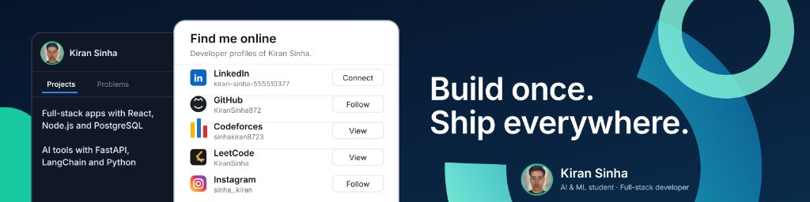

  

  B.Tech AI &amp; ML · Mirai School of Technology, Delhi · <strong>Open to Software &amp; Web Development internships</strong>

  <picture>
    <source media="(prefers-color-scheme: dark)" srcset="assets/divider-dark.svg">
    
  </picture>

## About me

B.Tech AI &amp; ML student with hands-on experience building production-grade full-stack applications and generative AI pipelines.
I work across the entire stack — React and Next.js frontends, Node.js / FastAPI backends, PostgreSQL and MongoDB databases, and RAG systems with LangChain and ChromaDB.
Currently seeking a **Software Development or Web Development internship** to apply and grow these skills in a professional environment.

&nbsp;&nbsp;🌐 &nbsp;**Portfolio:** [kiransinha-portfolio.vercel.app](https://kiransinha-portfolio.vercel.app)

  <picture>
    <source media="(prefers-color-scheme: dark)" srcset="assets/divider-dark.svg">
    
  </picture>

## Featured projects

<table>
  <tr>
    <td width="50%" valign="top">
      <h3><a href="https://github.com/KiranSinha872/AskPDF">AskPDF</a></h3>
      
RAG assistant that answers questions over any PDF with strict citations and zero hallucination, backed by ChromaDB + Gemini + FastAPI.

      

        
        
        
        
        
      

    </td>
    <td width="50%" valign="top">
      <h3><a href="https://github.com/KiranSinha872/staynest">StayNest</a></h3>
      
Full-stack Airbnb-style stay-booking platform with JWT auth, host/guest roles, date-range booking, and review system — built on the MERN stack.

      

        
        
        
        
      

    </td>
  </tr>
  <tr>
    <td width="50%" valign="top">
      <h3><a href="https://github.com/KiranSinha872/kiransinha-portfolio">Portfolio</a> &nbsp;</h3>
      
Personal developer portfolio built with Next.js, TypeScript, Tailwind CSS, and Firebase, featuring an interactive Vanta.js hero section.

      

        
        
        
        
      

    </td>
    <td width="50%" valign="top">
      <h3><a href="https://github.com/KiranSinha872/college-management-system">College Management System</a></h3>
      
Node.js + Express REST API for managing college students and teachers, with Mongoose models and MongoDB persistence.

      

        
        
        
      

    </td>
  </tr>
</table>

  <picture>
    <source media="(prefers-color-scheme: dark)" srcset="assets/divider-dark.svg">
    
  </picture>

## Open source contributions

<table>
  <tr>
    <td>
      <a href="https://github.com/freeCodeCamp/freeCodeCamp/pull/70560">
        <strong>freeCodeCamp/freeCodeCamp #70560</strong>
      </a>
      &nbsp;·&nbsp;
      
       
      <em>fix(curriculum): improve wording in Caesar Cipher step 23</em>
       
      Corrected unclear instruction text in the JavaScript Algorithms curriculum to reduce learner confusion. Merged 2 Oct 2026.
    </td>
  </tr>
</table>

  <picture>
    <source media="(prefers-color-scheme: dark)" srcset="assets/divider-dark.svg">
    
  </picture>

## Tech stack

**Programming languages**

  &nbsp;&nbsp;
  &nbsp;&nbsp;
  

**Web technologies**

  &nbsp;&nbsp;
  &nbsp;&nbsp;
  

**Frameworks &amp; libraries**

  &nbsp;&nbsp;
  <a href="https://nextjs.org" title="Next.js">
    <picture>
      <source media="(prefers-color-scheme: dark)" srcset="assets/logos/nextjs-light.svg">
      
    </picture>
  </a>&nbsp;&nbsp;
  &nbsp;&nbsp;
  <a href="https://expressjs.com" title="Express.js">
    <picture>
      <source media="(prefers-color-scheme: dark)" srcset="assets/logos/express-light.svg">
      
    </picture>
  </a>&nbsp;&nbsp;
  

**APIs &amp; real-time**

  <a href="https://socket.io" title="Socket.IO">
    <picture>
      <source media="(prefers-color-scheme: dark)" srcset="assets/logos/socketio-light.svg">
      
    </picture>
  </a>&nbsp;&nbsp;
  <a href="https://webrtc.org" title="WebRTC">
    <picture>
      <source media="(prefers-color-scheme: dark)" srcset="assets/logos/webrtc-light.svg">
      
    </picture>
  </a>

**Databases**

  &nbsp;&nbsp;
  &nbsp;&nbsp;
  &nbsp;&nbsp;
  

**AI &amp; generative AI**

  &nbsp;&nbsp;
  

  <code>RAG</code>&nbsp;
  <code>LLMs</code>&nbsp;
  <code>Prompt Engineering</code>

**AI tools**&nbsp;&nbsp;<code>ChatGPT</code>&nbsp;<code>Claude</code>&nbsp;<code>Gemini</code>

**Developer tools**

  &nbsp;&nbsp;
  <a href="https://github.com/KiranSinha872" title="GitHub">
    <picture>
      <source media="(prefers-color-scheme: dark)" srcset="assets/logos/github-light.svg">
      
    </picture>
  </a>&nbsp;&nbsp;
  &nbsp;&nbsp;
  

**CS fundamentals**&nbsp;&nbsp;<code>SDLC</code>&nbsp;<code>DBMS</code>&nbsp;<code>OOP</code>&nbsp;<code>Computer Networks</code>&nbsp;<code>System Design</code>

  <picture>
    <source media="(prefers-color-scheme: dark)" srcset="assets/divider-dark.svg">
    
  </picture>

## Competitive programming

  &nbsp;&nbsp;
  &nbsp;&nbsp;
  

  <picture>
    <source media="(prefers-color-scheme: dark)" srcset="assets/competitive.svg">
    
  </picture>

  <picture>
    <source media="(prefers-color-scheme: dark)" srcset="assets/divider-dark.svg">
    
  </picture>

## GitHub stats

  <picture>
    <source media="(prefers-color-scheme: dark)" srcset="https://github-readme-stats.vercel.app/api?username=KiranSinha872&show_icons=true&theme=transparent&text_color=94a3b8&icon_color=818cf8&title_color=818cf8&border_color=27272a&hide_border=false">
    
  </picture>
  &nbsp;&nbsp;
  <picture>
    <source media="(prefers-color-scheme: dark)" srcset="https://github-readme-streak-stats.herokuapp.com?user=KiranSinha872&theme=transparent&background=00000000&ring=818cf8&fire=818cf8&currStreakLabel=818cf8&sideLabels=94a3b8&currStreakNum=f8fafc&sideNums=f8fafc&dates=94a3b8&border=27272a">
    
  </picture>

  <picture>
    <source media="(prefers-color-scheme: dark)" srcset="assets/divider-dark.svg">
    
  </picture>

## Education

| Degree | Institution | Period |
| :--- | :--- | :--- |
| **B.Tech — Artificial Intelligence &amp; Machine Learning** | Mirai School of Technology, Delhi | 2025 – 2029 |
| **Higher Secondary (Class XII) — Science** | Gurucharan College, Silchar, Assam | 2023 – 2025 |
| **Secondary School (Class X)** — 89.9% | Surendra Singha Memorial English School, Silchar, Assam | — |

  <picture>
    <source media="(prefers-color-scheme: dark)" srcset="assets/divider-dark.svg">
    
  </picture>

## Connect with me

  &nbsp;&nbsp;
  <a href="https://github.com/KiranSinha872" title="GitHub">
    <picture>
      <source media="(prefers-color-scheme: dark)" srcset="assets/logos/github-light.svg">
      
    </picture>
  </a>&nbsp;&nbsp;
  

